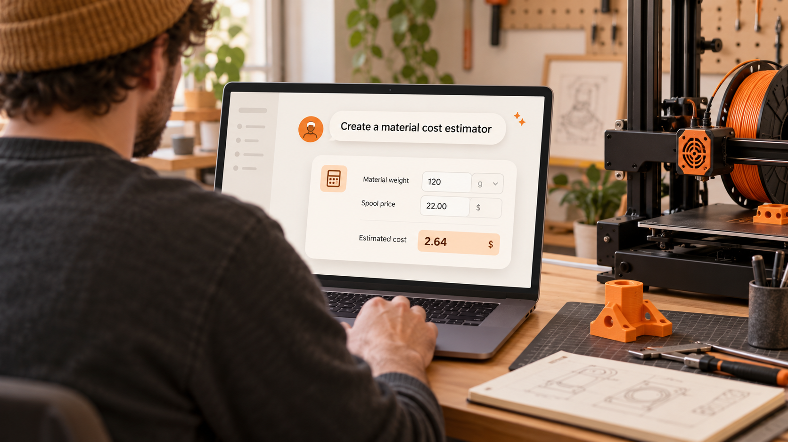
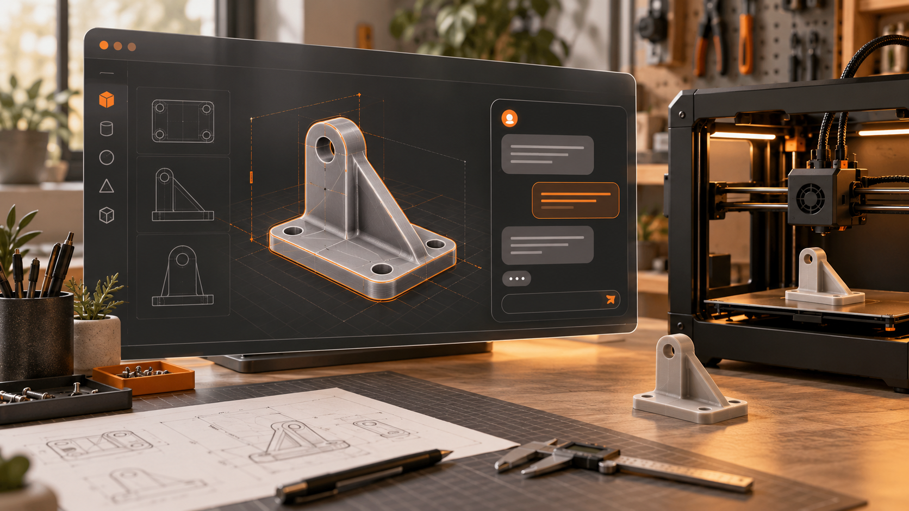
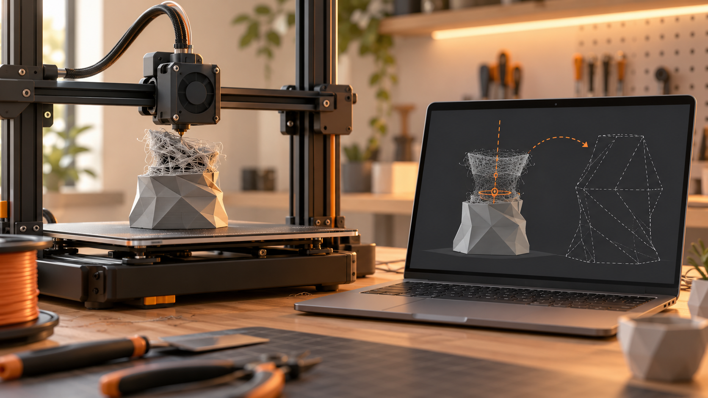
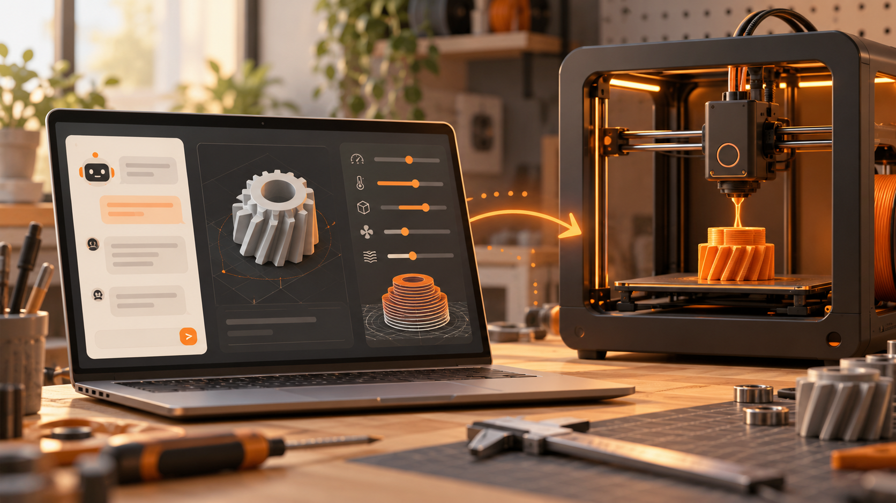
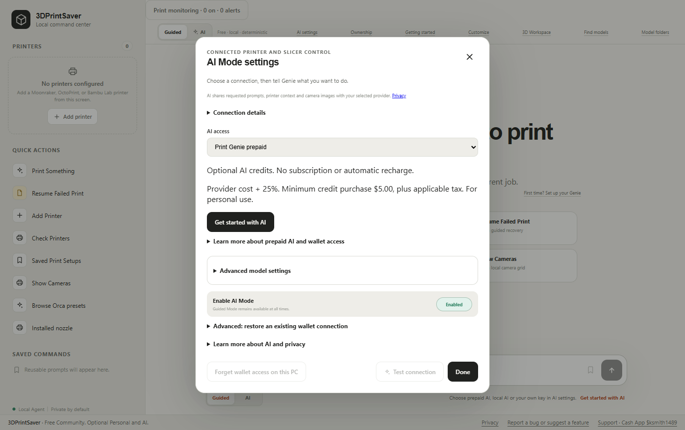

# Print Genie

### From an idea to a finished print, with a little help from Genie.

Print Genie brings your 3D printing workflow together: connect a supported printer, work on a model, prepare a print, and recover a print that didn't make it to the finish. Use guided tools on your own, or bring an AI assistant into the conversation.

[Explore the website](https://3dprintsaver.com) · [View 3DPrintSaver in the Microsoft Store](https://apps.microsoft.com/detail/9NHNCJD6MM0V) · [Discover Personal Edition](https://3dprintsaver.com/personal)

Print Genie is the experience behind **3DPrintSaver**, its Microsoft Store listing. Availability of the Store listing can vary by region and publication status.

## Make your Personal Edition your own

Your workshop is unique. With **Personal Edition**, you can ask Genie to create useful tools for the way you work. For example, describe a material cost estimator that calculates filament costs, waste and markup for a print. Review and test the proposed calculator, then install it in your own app. You can also create custom checklists and read-only information panels, revise them over time, and return to an earlier version.

*Conceptual illustration; not an actual application screenshot.*

Made something useful? Export a supported customization as a sharing file and share it with the community or directly with another Personal owner, who can import, review and install it. Customizations currently use supported data-only tools; creating arbitrary executable plugins or new printer integrations is not available. Generating a customization requires a compatible AI connection; provider and prepaid AI charges are separate, and compatible local models are also supported.

## Imagine it. Make it.

Describe the part you have in mind, explore a design in the 3D workspace, and work toward a model you can print. Connected AI can help with modeling and revisions using available tools such as FreeCAD and Blender, which are installed separately.

*Conceptual illustration; not an actual application screenshot.*

## Give a failed print another chance

When a print fails, use the original G-code and your measurement to work through recovery. Guided tools support recovery for prints still attached to the bed and for loose prints that need a landing pad and alignment. A connected AI assistant can help you navigate the workflow and operate available printer tools.

*Conceptual illustration; not an actual application screenshot. Recovery depends on your printer, the original file, and the circumstances of the failure. Bambu printers do not currently support the canonical recovery workflow.*

## From slicer settings to print

Tell Genie what you want to print and discuss the slicer settings that suit your material and printer. With OrcaSlicer installed and a compatible connected printer, the assistant can inspect profiles, recommend settings, apply approved changes in a separate preset, slice the model, and start a print when requested.

*Conceptual illustration; not an actual application screenshot. Available actions depend on your setup and integrations.*

## A look at the app

*Actual preview capture of the Community Edition AI settings. The final release may look different.*

## Choose how you use Print Genie

| | Community | Personal |
| --- | --- | --- |
| Price | Free | **$29.99 USD once**, plus applicable taxes |
| Printing and recovery | Guided printer tools and failed-print recovery | Includes Community features |
| AI options | Optional prepaid AI | Prepaid AI, your own provider key, or compatible local models |
| Make it your own | Guided workflows | Customize and lifetime software upgrades |

Personal is a one-time software purchase, not an AI subscription. AI provider usage and optional prepaid AI services are separate charges. After purchasing Personal, save your signed ownership file and recovery information, then import the file in the app's Ownership settings. [Learn more or restore a purchase](https://3dprintsaver.com/personal).

## Get started

Visit the [3DPrintSaver Microsoft Store listing](https://apps.microsoft.com/detail/9NHNCJD6MM0V) or [3dprintsaver.com](https://3dprintsaver.com). A supported Windows computer and compatible printer setup are needed for printer functions. AI is optional for guided workflows; specific AI, modeling, and slicing features may require additional services or software.

The first direct GitHub download is being prepared. When a release is available, find it in this repository's **Releases** section. See [installation and download safety](docs/INSTALL.md) and the [draft release notes](releases/v0.13.22.md). Do not install an unsigned or unexpected package.

## About this repository

This repository is for public product information, release notes, and official downloads. Print Genie's application source and development repositories are proprietary and remain private. Releases will include applicable third-party notices and the matching source and license for the GPL-licensed Blender bridge. See [third-party information](docs/THIRD-PARTY.md).

Questions or security issues? [Contact support](mailto:Ken@3dprintsaver.com). Please do not post credentials, ownership files, private models, or security vulnerabilities in public issues.
